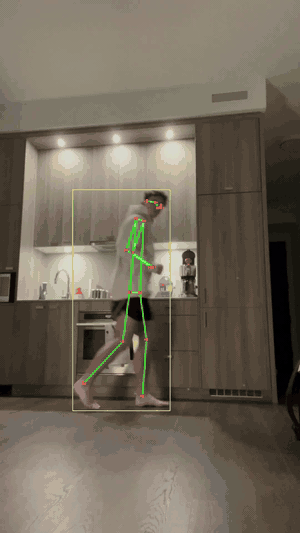

# Sports Vision

A local-only tool that analyzes phone video of a training session and shows how
form changes as fatigue builds. Nothing is uploaded: video, models and results
all stay on your device.

## Demo

  

Person tracking on a short indoor jog clip, running entirely on a MacBook Pro M5.

## MVP:
Current demo is just person tracking, working on the bike trainer now. Hopefully with these key measurements: 

- Cadence and how it drifts over a ride
- Knee extension at the bottom of the pedal stroke (side view)
- Hip sway and left/right differences (rear view)
- Torso angle over time
- Early-session vs late-session comparison, and session-vs-session trends

Injury-risk flags are "worth a look" signals only. 

## Long-term goal

Use this for all of my Ironman training: bike and run first, and basketball as a
side sport. Swimming is not planned. Comparisons are against my own history
(a personal dataset built up session by session), which will make it highly interactive. 

## How it works

- Pose estimation: ViTPose+ Large (`usyd-community/vitpose-plus-large`)
- Person detection: RT-DETR (`PekingU/rtdetr_r50vd_coco_o365`)
- Runtime: PyTorch + Hugging Face Transformers, Apple Silicon GPU (MPS)
- Early result: ~164 ms per frame on an M5 MacBook Pro; the first test clip
  tracked the person in 211 of 211 frames (visual check only, not yet validated
  against ground truth)

## License

Licensed under the [Apache License 2.0](LICENSE).
